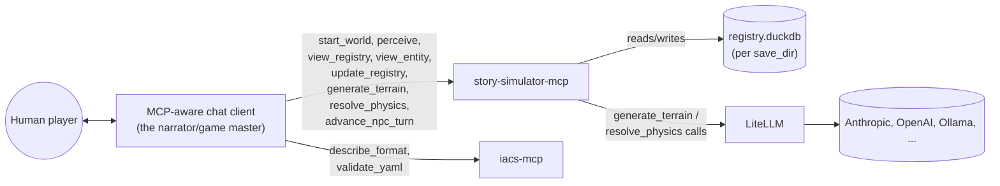
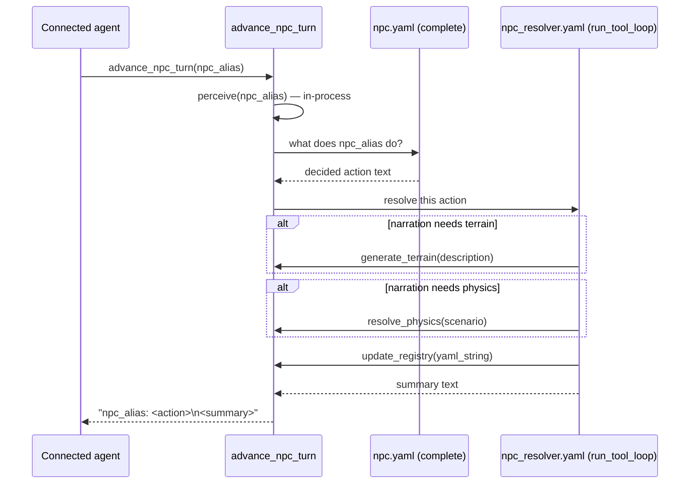

# Architecture

story-simulator is **just an MCP server**. There is no agent loop inside
this project — the loop is whatever MCP-aware client connects (a human's
chat agent, an automated harness, ...). story-simulator's job is to expose
good tools for playing a text simulation whose state lives in a structured
entity/component registry ([`iacs`](../iacs)), not in the connected agent's
own context.

## 1. Who plays which role

For a human player, narration is just the connected agent's own replies —
nothing in story-simulator narrates *for* it. The agent calls `perceive`/
`view_registry`/`view_entity` to see what's going on, calls
`generate_terrain`/`resolve_physics` when it wants a specialist's judgment,
writes its own reply directly to the player, and calls `update_registry` to
record what happened. `iacs-mcp` (attached alongside, unmodified) stays the
format/validation reference — `describe_format`/`validate_yaml` — since it
has no way to see story-simulator's live, accumulating registry state (its
own `load_manifest` only re-reads static files).

## 2. Tools

| Tool | Needs `start_world` first? | What it does |
|---|---|---|
| `start_world(save_dir, settings_dir=None)` | — | Opens or seeds a save, remembered for this session. |
| `view_registry(component_type)` | yes | CSV dump of every recorded instance of a component type. |
| `view_entity(entity_id)` | yes | Every recorded component instance for one entity. |
| `update_registry(yaml_string)` | yes | Merge entity-first YAML into the registry. |
| `perceive(reference_alias, radius=20.0)` | yes | Nearby entities for `reference_alias`, tagging them `active` and merging them into its permanent `memory` — same computation the old per-turn `MapSystem` did, now on demand (`story_simulator/spatial.py`). |
| `generate_terrain(description)` | no | `TerrainAgent` — one LiteLLM call, its own held credentials/model. |
| `resolve_physics(scenario)` | no | `PhysicsAgent` — same shape. |
| `advance_npc_turn(npc_alias)` | yes | Decides, narrates, and records one NPC's turn end-to-end — the one case with nobody chatting to drive it. |

## 3. `advance_npc_turn`: a tool that calls other tools

Nested tool calls are how an autonomous NPC turn gets resolved without a
human or connected chat agent driving it — the outer caller sees one opaque
tool call; internally it decides, then runs its own small tool-calling loop
(`agents.run_tool_loop`, unchanged from before) that can call
`generate_terrain`/`resolve_physics`/`update_registry` in-process before
returning.

## 4. What's still shared with before

`story_simulator/agents.py` (`AgentSpec`, `complete`, `run_tool_loop`) and
`story_simulator/specialists.py` (`TerrainAgent`, `PhysicsAgent`) are
unchanged from the previous LiteLLM migration — they just get called from
MCP tool handlers now instead of a `System.step()`. `manifest/builtins.yaml`
and the `iacs` registry model are untouched.

## 5. What's out of scope today

- **Bring-your-own-agent (EC-defined agents)** isn't implemented. The
  unwired `agent` component type reserved in `manifest/builtins.yaml`
  (`role`/`model`/`system_prompt`) is still just a reservation.
- **Per-provider credential management** is minimal: `resolve_anthropic_api_key()`
  (`story_simulator/config.py`) covers Anthropic-flavored `model:` strings
  for `generate_terrain`/`resolve_physics`/`advance_npc_turn`'s own calls;
  any other provider relies on LiteLLM's own standard env-var discovery.
- **`render()`** (the old `VisualizerSystem`'s SVG position plot) hasn't
  been ported to a tool yet — a natural, low-risk follow-up, not done here.
- **MCP sampling** (asking the *connected client* to fulfill
  `generate_terrain`/`resolve_physics` using its own model/credentials,
  instead of story-simulator holding its own) was considered and deferred —
  it's human-in-the-loop by design and client support is inconsistent as of
  this writing, which risks a lot of approval friction for calls this
  frequent.
