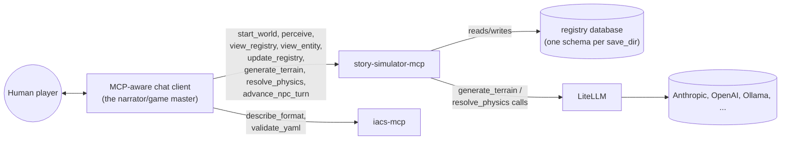
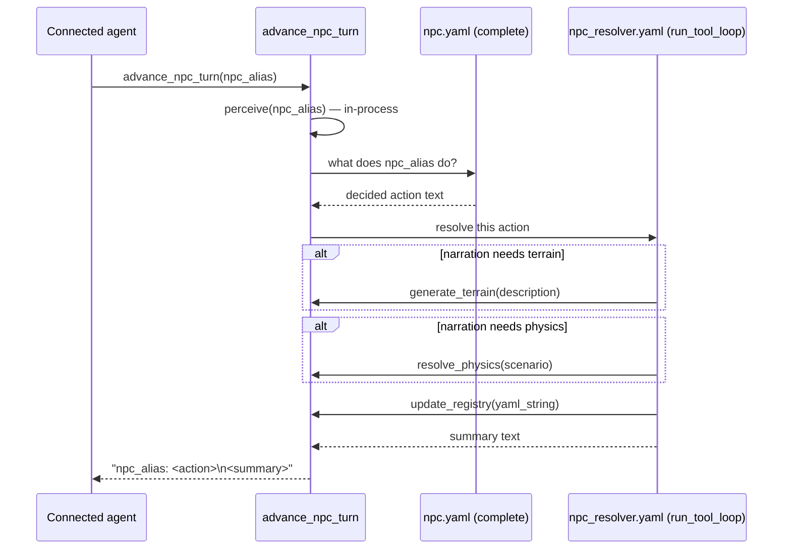

# Architecture

story-simulator is **just an MCP server**. There is no agent loop inside
this project — the loop is whatever MCP-aware client connects (a human's
chat agent, an automated harness, ...). story-simulator's job is to expose
good tools for playing a text simulation whose state lives in a structured
entity/component registry ([`iacs`](../iacs)), not in the connected agent's
own context.

## 1. Who plays which role

For a human player, narration is just the connected agent's own replies —
nothing in story-simulator narrates *for* it. The agent calls `perceive`/
`view_registry`/`view_entity` to see what's going on, calls
`generate_terrain`/`resolve_physics` when it wants a specialist's judgment,
writes its own reply directly to the player, and calls `update_registry` to
record what happened. `iacs-mcp` (attached alongside, unmodified) stays the
format/validation reference — `describe_format`/`validate_yaml` — since it
has no way to see story-simulator's live, accumulating registry state (its
own `load_manifest` only re-reads static files).

## 2. Tools

| Tool | Needs `start_world` first? | What it does |
|---|---|---|
| `start_world(save_dir, settings_dir=None)` | — | Opens or seeds a save, remembered for this session. |
| `view_registry(component_type)` | yes | CSV dump of every recorded instance of a component type. |
| `view_entity(entity_id)` | yes | Every recorded component instance for one entity. |
| `update_registry(yaml_string)` | yes | Merge entity-first YAML into the registry. |
| `perceive(reference_alias, radius=20.0)` | yes | Nearby entities for `reference_alias`, tagging them `active` and merging them into its permanent `memory` — same computation the old per-turn `MapSystem` did, now on demand (`story_simulator/spatial.py`). |
| `generate_terrain(description)` | no | `TerrainAgent` — one LiteLLM call, its own held credentials/model. |
| `resolve_physics(scenario)` | no | `PhysicsAgent` — same shape. |
| `advance_npc_turn(npc_alias)` | yes | Decides, narrates, and records one NPC's turn end-to-end — the one case with nobody chatting to drive it. |

## 3. `advance_npc_turn`: a tool that calls other tools

Nested tool calls are how an autonomous NPC turn gets resolved without a
human or connected chat agent driving it — the outer caller sees one opaque
tool call; internally it decides, then runs its own small tool-calling loop
(`agents.run_tool_loop`, unchanged from before) that can call
`generate_terrain`/`resolve_physics`/`update_registry` in-process before
returning.

## 4. What's still shared with before

`story_simulator/agents.py` (`AgentSpec`, `complete`, `run_tool_loop`) and
`story_simulator/specialists.py` (`TerrainAgent`, `PhysicsAgent`) are
unchanged from the previous LiteLLM migration — they just get called from
MCP tool handlers now instead of a `System.step()`. `manifest/builtins.yaml`
and the `iacs` registry model are untouched.

## 5. What's out of scope today

- **Bring-your-own-agent (EC-defined agents)** isn't implemented. The
  unwired `agent` component type reserved in `manifest/builtins.yaml`
  (`role`/`model`/`system_prompt`) is still just a reservation.
- **Per-provider credential management** is minimal: `resolve_anthropic_api_key()`
  (`story_simulator/config.py`) covers Anthropic-flavored `model:` strings
  for `generate_terrain`/`resolve_physics`/`advance_npc_turn`'s own calls;
  any other provider relies on LiteLLM's own standard env-var discovery.
- **`render()`** (the old `VisualizerSystem`'s SVG position plot) hasn't
  been ported to a tool yet — a natural, low-risk follow-up, not done here.
- **MCP sampling** (asking the *connected client* to fulfill
  `generate_terrain`/`resolve_physics` using its own model/credentials,
  instead of story-simulator holding its own) was considered and deferred —
  it's human-in-the-loop by design and client support is inconsistent as of
  this writing, which risks a lot of approval friction for calls this
  frequent.

## 6. Follow-ups

Things this rebuild surfaced or left open, not addressed here:

- **Revalidate the human-validated (live) tests.** `tests/test_human_validated.py`
  tested `EnsembleWorld`/`Interpreter` end-to-end against a real model
  (`test_startup_one_loop_save`, `test_move`, `test_npc`) and was removed
  along with those classes. Verification since has been: unit tests against
  individual tool functions with a mocked LLM, plus one manual MCP client
  handshake (`list_tools`/`start_world`/`perceive`) — no real-model coverage
  of narration content, `advance_npc_turn`'s actual LLM behavior, or a
  multi-turn play session. Need a new `@pytest.mark.live` suite for this
  shape: at minimum real-model tests for `generate_terrain`/`resolve_physics`/
  `advance_npc_turn` (the tools with LLM calls inside them), and ideally a
  scripted client that drives a realistic multi-tool-call sequence against a
  real save to confirm the tools compose correctly — harder to automate than
  before, since narration itself now lives in whatever external agent
  connects rather than one Python entry point like `EnsembleWorld.advance()`.

- **Create an iacs manifest for story-simulator's own architecture.** iacs is
  built for exactly this (requirement/solution/component entities, plus
  built-in Requirement Coverage, Traceability, and Todo audits — see
  `iacs/CLAUDE.md`), but story-simulator has only ever used it as the
  world-state backend, never on itself. Add a manifest (e.g.
  `manifest/architecture.yaml`) modeling what each tool needs to guarantee
  as `requirement` entities and which code satisfies it as `solution of`
  entities, so `run_dataflow("audit.requirement_coverage")`/`"audit.traceability"`
  can run against the project's own design — catching an unsolved
  requirement or orphaned code, and giving reviewers a structured, queryable
  map alongside this prose doc.

- **Restrict the NPC's write access — it should only say what it wants to
  do.** Real gap in the current `advance_npc_turn`: its nested narrate/record
  step (`npc_resolver.yaml` via `run_tool_loop`) is handed `update_registry`
  directly, so an NPC's automated turn ends up with the same unrestricted
  write authority as a full narrator. That's inconsistent with how a human
  player's command works — the player's input never itself writes anything;
  the *connected agent* does, with full narrator authority. The NPC's decide
  step (`_build_npc_decision_prompt` + `complete()`) is already correctly
  scoped (perceive-limited view, no tools at all) — it's the narrate+record
  step that piggybacks unrestricted authority onto the same automated turn.
  Needs a redesign that keeps "decide" (restricted, intent-only, no tools)
  separate from "resolve and record" (needs broader authority), and
  reconsiders whether the latter belongs in `advance_npc_turn` at all versus
  being handed to whichever narrator already holds that authority — reserving
  full autonomy for the case where genuinely nobody is watching.

- **Agents default to reading the seed YAML instead of the live registry.**
  **Root-cause fix implemented.** Coding agents (and probably most agents)
  are optimized for text-file development, so left to their own defaults
  they'll grep/read `data/*/setting.yaml` when asked about world state —
  but that file is only ever a save's *starting* seed (`_seed_save_dir`
  copies it once, on a brand-new `save_dir`), frozen from then on (verified
  directly: after several `update_registry` calls that changed a door's
  recorded description, the seed was still byte-identical to the original,
  untouched mtime and all).

  Fixed by making the registry sync itself back out to disk instead of
  relying on an agent to remember it's not the source of truth:
  `update_registry` (and the NPC turn's own internal registry write, via
  the shared `_update_registry_and_sync` helper) now calls
  `Registrar.export_manifest(output_dir=save_dir)` after every merge,
  re-exporting the full current registry to `save_dir/world.yaml` —
  the same `save_dir/world.yaml` filename the old, since-removed
  `IacsArchivist` design used, but built the opposite direction. That
  design had an agent *author* YAML into the registry from a growing
  `world.yaml`; here the registry stays the single source of truth and
  `world.yaml` is a generated, read-only mirror of it, rewritten in full
  each turn (not incrementally). `export_manifest` also round-trips this
  project's own field-schema manifest (merged into every registry via
  `input_dirs=[MANIFEST_DIR]`) into a `builtins.yaml` alongside it; since
  that's just static schema, not game state, `_export_world_yaml` deletes
  it rather than let it accumulate in `save_dir`. The original seed YAML
  itself (`setting.yaml`/wherever `settings_dir` pointed) is still never
  touched — only the new `world.yaml` mirror is written.

  Not fully closed: an agent could still default to grepping `setting.yaml`
  specifically (the seed, still frozen) instead of the now-live
  `world.yaml`, or not know `world.yaml` exists at all. Remaining candidate
  fixes to point agents at it: a repo-root `CLAUDE.md` (read automatically
  by Claude Code sessions in this repo — already exists, could mention
  `world.yaml`), a line added to the MCP server's own `instructions` string
  in `story_simulator/mcp_server.py` (read automatically by any connected
  MCP client, not just Claude Code), and/or a comment at the top of each
  seed YAML under `data/` pointing at the live mirror.

- **Review `CLAUDE.md` periodically and extract what's MCP-appropriate.**
  `CLAUDE.md` has accumulated real operational knowledge from dev/playtest
  sessions — the `story-simulator-mcp` reload trick, the `world.yaml` sync
  note above, silent recovery from an idle-triggered mid-play disconnect —
  but it only ever reaches Claude Code sessions in this repo, which is a
  narrower audience than "whoever is narrating a story-simulator world."
  Anything that's true of the *game* rather than of *this specific dev
  environment* (the `world.yaml`-is-current note is the clear example; the
  reload trick and disconnect recovery are more Claude-Code/session-specific
  and may belong staying put) is a candidate to fold into the MCP server's
  own `instructions` string in `story_simulator/mcp_server.py`, which
  reaches any connected MCP client, not just Claude Code. Needs a pass to
  sort which entries are which and move the game-level ones over.

- **Evaluate a "world time" distinct from system time.** `_next_turn_stamp()`
  (`int(time.time())`) is a narrow technical fix — a monotonic ordering value
  so `Registry.view_current` can resolve which of an entity's accumulated
  position rows is current, now that there's no global turn counter. It
  isn't, and shouldn't be conflated with, an in-fiction clock. The story
  itself has no representation of elapsed narrative time today (how long a
  character has walked, day/night, the living world's "teleport a year
  forward" door mechanic is currently just narration with no backing data).
  Worth evaluating an explicit world-time concept — a component tracking
  in-fiction elapsed time/calendar, independent of wall-clock ordering — so
  the simulation can reason about story-internal chronology instead of only
  narrating it.
