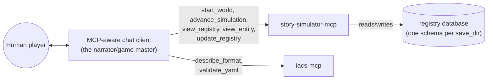
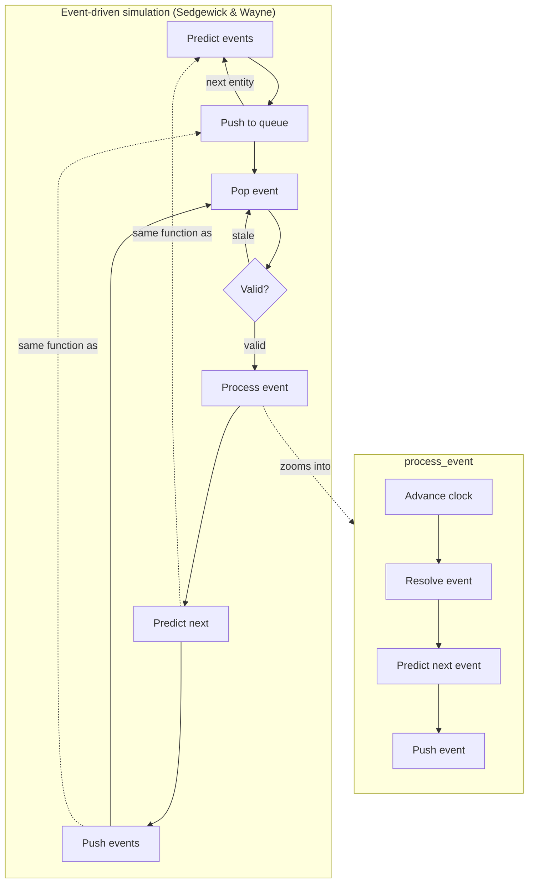

# Architecture

story-simulator is **just an MCP server**. There is no agent loop inside
this project — the loop is whatever MCP-aware client connects (a human's
chat agent, an automated harness, ...). story-simulator's job is to expose
good tools for playing a text simulation whose state lives in a structured
entity/component registry ([`iacs`](../iacs)), not in the connected agent's
own context.

What each tool must guarantee, what code satisfies it, and every open
follow-up are modeled as `requirement`/`solution` entities in
[`docs/manifest/story-simulator.yaml`](manifest/story-simulator.yaml), not
duplicated here as prose — load it with the iacs MCP server
(`load_manifest(["docs/manifest", "story_simulator"])`, since most solutions
now live as `__iacs__` metadata in code docstrings rather than in the YAML)
and run `run_dataflow("audit.requirement_coverage")`/`("audit.traceability")`
to check current status, or query `resolved_impact_cost` for a cost-vs-impact
read on what's still open.

## Who plays which role

For a human player, narration is just the connected agent's own replies —
nothing in story-simulator narrates *for* it. `iacs-mcp` (attached alongside,
unmodified) stays the format/validation reference — `describe_format`/
`validate_yaml` — since it has no way to see story-simulator's live,
accumulating registry state (its own `load_manifest` only re-reads static
files).

> **Character/NPC/terrain/physics/spatial-perception tools are currently
> shelved** (`perceive`, `advance_npc_turn`, `generate_terrain`,
> `resolve_physics`, and the character-aware branch the event loop below
> used to take) — moved to [`shelved/`](../shelved) rather than deleted;
> see [`shelved/README.md`](../shelved/README.md) and git history to pull
> any of it back in. What's below reflects what's actually live.

## The event-driven turn loop

Turns aren't a fixed round-robin over every entity — they're scheduled,
Sedgewick & Wayne style (*Algorithms*, 4th ed., §6.1 Event-Driven
Simulation): every entity carries its own `next_due` time in the registry,
and the loop only ever pops whichever entity is due soonest, discarding
stale events rather than replaying them. `predict_next_event`/`push_event`
is the same function at both call sites in the diagram below — scheduling
a brand-new entity's first event and rescheduling after one resolves are
the same operation, not two.

`story_simulator/core.py` holds this event-loop kernel (`pop_event`,
`is_event_valid`, `advance_clock`, `predict_next_event`, `push_event`).
`story_simulator/mcp_server.py`'s `_run_event_loop` drives it, dispatching
each popped entity straight to `process_event`
(`resolve_event` asks the connected host what happens via
`story_simulator.resolve.TurnReplay`, `responder="host"` by default or
`"subagent"` if `STORY_SIM_RESPONDER=subagent` is set — see
`story_simulator.config.event_responder` — then predicts/pushes the
next event). A `_process_due_entity` seam used to sit between the two,
kept specifically for a character-aware branch to return to; once that
branch moved to `shelved/` there was nothing left to dispatch between,
so the seam was removed too — a future character-aware branch would need
its own dispatch step again, not assume this one still exists.

`"subagent"` doesn't ask the connected host to decide inline; its prompt
instead asks the host to answer via its own isolated subagent mechanism
(e.g. Claude Code's Agent/Task tool), giving each base event's judgment
call the same context isolation a real subagent call would, without
story-simulator needing an API key of its own. This is the piece of
[PR #42](https://github.com/zhafen/story-simulator/pull/42) ("Rename
responders and add isolated subagent delegation option") that PR itself
never wired up — even there, `resolve_event` stayed hardcoded to
`"host"`, "subagent" existed only as unused infrastructure. It's opt-in
and defaults to `"host"` (today's only behavior, unchanged) rather than
forced on, since nothing verifies a `"subagent"`-labeled answer actually
came from an isolated call rather than the host just answering inline —
see the TODO in `story_simulator.resolve._frame_for_responder`.

This diagram matches
[`docs/architecture/advance_simulation.md`](architecture/advance_simulation.md)'s
automated trace from the real entry point — see that page for the
generated version and how the two were reconciled.

Pausing/resuming (`NeedsExternalInput`, `resume_token`, MRTR — Multi
Round-Trip Requests, MCP spec 2026-07-28) isn't drawn here, same as
before: it's not a step in the loop's own shape, it's how "Resolve
event" reaches back out to the connected host without every intervening
function needing to be a generator — see
`story_simulator/resolve.py`'s own docstring, or the sequence-style trace
in [`docs/architecture/advance_simulation.md`](architecture/advance_simulation.md).

## Generated file/call-structure diagram

The diagrams above are hand-drawn, each making one specific point. For a
diagram of the actual file/call structure — not curated, whatever the
source currently is — see
[`docs/architecture/story_simulator.md`](architecture/story_simulator.md)
(the whole-project overview: one node per file, `mcp_server` as the hub —
it calls into `config`, `core`, and `resolve`; that's the whole file list
now that the character/npc/physics/terrain/spatial modules are shelved —
see below) or
[`docs/architecture/advance_simulation.md`](architecture/advance_simulation.md)
(the same thing traced outward from one specific entry point instead of
collapsed to the whole-project overview).

Both are produced by `iacs generate-architecture-diagram`, a capability
that lives on [`zhafen/iacs#claude/architecture-diagrams`](https://github.com/zhafen/iacs/tree/claude/architecture-diagrams),
not yet on iacs's `main` — regenerating in place isn't possible until that
branch merges and the submodule pointer bumps. `story_simulator.md` is
kept as *exactly* that command's raw output (safe to overwrite wholesale
on every regenerate); commentary about it lives here instead, precisely so
regenerating never clobbers hand-written explanation the way mixing the
two in one file would.
`mcp_client.py` has no edges in that diagram because none of its own
entities have a docstring yet (see `load_python`'s own docstring for why
undocumented code is excluded rather than shown as noise) — it isn't
disconnected from the real system, just from what's currently documented.
