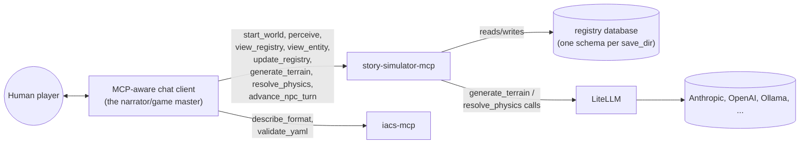
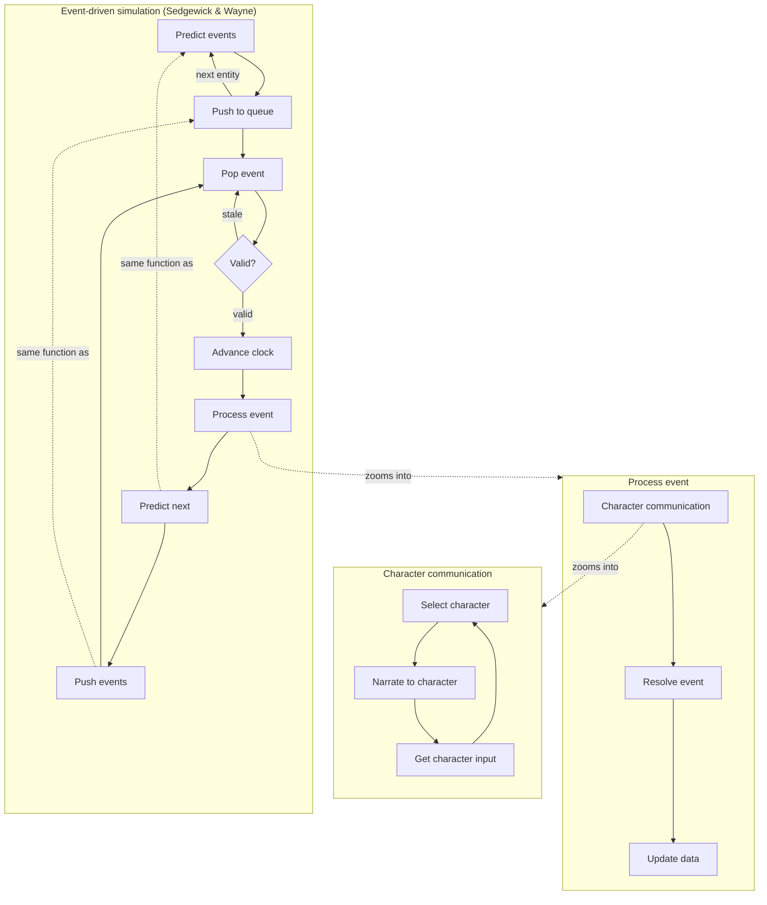
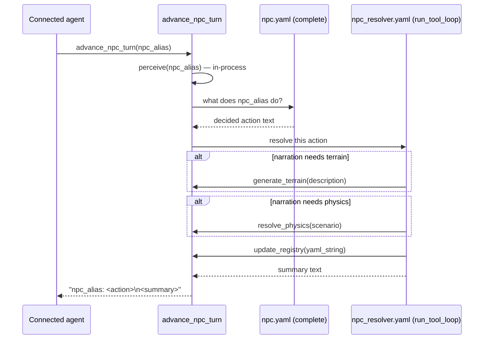

# Architecture

story-simulator is **just an MCP server**. There is no agent loop inside
this project — the loop is whatever MCP-aware client connects (a human's
chat agent, an automated harness, ...). story-simulator's job is to expose
good tools for playing a text simulation whose state lives in a structured
entity/component registry ([`iacs`](../iacs)), not in the connected agent's
own context.

What each tool must guarantee, what code satisfies it, and every open
follow-up are modeled as `requirement`/`solution` entities in
[`docs/manifest/story-simulator.yaml`](manifest/story-simulator.yaml), not
duplicated here as prose — load it with the iacs MCP server
(`load_manifest(["docs/manifest", "story_simulator"])`, since most solutions
now live as `__iacs__` metadata in code docstrings rather than in the YAML)
and run `run_dataflow("audit.requirement_coverage")`/`("audit.traceability")`
to check current status, or query `resolved_impact_cost` for a cost-vs-impact
read on what's still open.

## Who plays which role

For a human player, narration is just the connected agent's own replies —
nothing in story-simulator narrates *for* it. `iacs-mcp` (attached alongside,
unmodified) stays the format/validation reference — `describe_format`/
`validate_yaml` — since it has no way to see story-simulator's live,
accumulating registry state (its own `load_manifest` only re-reads static
files).

## The event-driven turn loop

Turns aren't a fixed round-robin over every character — they're scheduled,
Sedgewick & Wayne style (*Algorithms*, 4th ed., §6.1 Event-Driven
Simulation): every entity carries its own `next_due` time in the registry,
and the loop only ever pops whichever entity is due soonest, discarding
stale events rather than replaying them. `predict_event`/`push_event` is
the same function at both call sites in the diagram below — scheduling a
brand-new entity's first event and rescheduling after one resolves are the
same operation, not two.

`story_simulator/core.py` holds this event-loop kernel (`pop_event`,
`is_event_valid`, `advance_clock`, `predict_event`, `push_event`).
`story_simulator/mcp_server.py` holds the turn-processing layer that zooms
into whichever event `core.py` just popped (`process_event`,
`character_communication`, `resolve_event`, `update_data`), which in turn
loops `select_character`/`narrate_to_character`
(`story_simulator/spatial.py`) with `get_character_input`
(`story_simulator/mcp_server.py`) until that character's due action is
fully decided.

## `advance_npc_turn`: a tool that calls other tools

Nested tool calls are how an autonomous NPC turn gets resolved without a
human or connected chat agent driving it — the outer caller sees one opaque
tool call; internally it decides, then runs its own small tool-calling loop
(`agents.run_tool_loop`) that can call
`generate_terrain`/`resolve_physics`/`update_registry` in-process before
returning.

