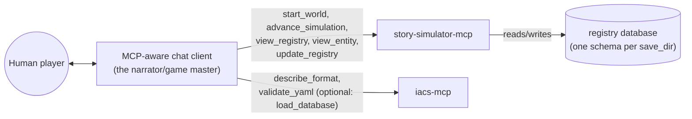
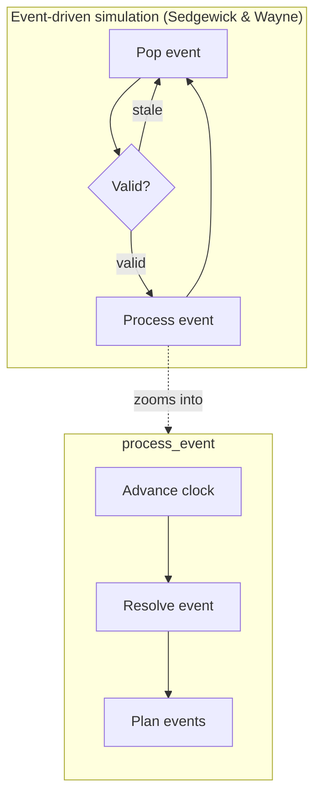

# Architecture

story-simulator is **just an MCP server**. There is no agent loop inside
this project — the loop is whatever MCP-aware client connects (a human's
chat agent, an automated harness, ...). story-simulator's job is to expose
good tools for playing a text simulation whose state lives in a structured
entity/component registry ([`iacs`](../iacs)), not in the connected agent's
own context.

What each tool must guarantee and what code satisfies it are modeled as
`requirement`/`solution` entities in
[`docs/manifest/story-simulator.yaml`](manifest/story-simulator.yaml), not
duplicated here as prose — load it with the iacs MCP server
(`load_manifest(["docs/manifest", "story_simulator"])`, since most solutions
now live as `__iacs__` metadata in code docstrings rather than in the YAML).

As of [Epic B](https://github.com/zhafen/story-simulator/issues/47)
(2026-08-13), that manifest is scoped specifically to the *candidate-goal
backlog*: not-yet-started or undecided work, each scored with `impact`/`cost`
so `resolved_impact_cost` can drive a cost-vs-impact read on what's worth
picking up next. A goal graduates out of the manifest the moment it becomes
actively worked — it's filed as its own GitHub issue instead, for richer
tracking/visualization, and its manifest entry is removed at that point.
`run_dataflow("audit.requirement_coverage")`/`("audit.traceability")` still
run the same way over whatever's left in the tree; they just no longer double
as the project's active-work tracker. The requirement/solution schema itself
— how requirements get modeled and how solution options get picked between —
is a separate, unsolved problem, deliberately out of scope here.

## Who plays which role

For a human player, narration is just the connected agent's own replies —
nothing in story-simulator narrates *for* it. `view_registry`/`view_entity`
are story-simulator's own tools, but delegate internally to iacs's own
`Registrar.view_df`/`view_entity` methods against the same registrar object
`start_world` already opened — a single in-process call, not a second MCP
round-trip. `iacs-mcp` (attached alongside, unmodified in this flow) stays
the format/validation reference — `describe_format`/`validate_yaml` — since
those don't need the live registry at all; its own `load_database` tool
can optionally point its deeper introspection tools at this exact world
too, but nothing on the ordinary read path depends on a host discovering
and calling it. Two earlier iterations tried routing all reads through
`iacs-mcp` instead (once via a nudge, once by removing story-simulator's
own tools outright) — reverted after live evidence that a connected host
reliably discovers and uses tools on the server it's already talking to,
but never once discovered or called a tool on a separate one (see
`docs/manifest/history.yaml`: `project_history.
iacs_mcp_pointed_at_live_registry_for_component_discovery`,
`project_history.story_simulator_view_tools_removed_in_favor_of_iacs`, and
`project_history.story_simulator_view_tools_reinstated_as_iacs_delegates`).

> **Character/NPC/terrain/physics/spatial-perception tools are currently
> shelved** (`perceive`, `advance_npc_turn`, `generate_terrain`,
> `resolve_physics`, and the character-aware branch the event loop below
> used to take) — moved to [`shelved/`](../shelved) rather than deleted;
> see [`shelved/README.md`](../shelved/README.md) and git history to pull
> any of it back in. What's below reflects what's actually live.

## The event-driven turn loop

Turns aren't a fixed round-robin over every entity — they're scheduled,
Sedgewick & Wayne style (*Algorithms*, 4th ed., §6.1 Event-Driven
Simulation): the schedule is `event` entities' own `start_time`/`duration`
(`manifest/builtins.yaml`'s `event_components`), not an in-memory priority
queue and not a rescheduled `next_due` component — an event's timing is
set once, either pre-planned in a scenario or by a responder's own
`plan_events` call, and never revised afterward. The loop only ever pops
whichever `event` is due soonest (`start_time + duration`, computed fresh
from the registry every call), discarding terminal (`complete`/
`interrupted`) events rather than replaying them.

`story_simulator/core.py` holds this event-loop kernel (`pop_event`,
`is_event_valid`, `advance_clock`, `resolve_event`, `plan_events`) and,
since it also absorbed the bulk of what used to be `mcp_server.py`'s own
implementation (see that module's docstring for why), the loop that drives
it too: `_run_event_loop` dispatches each popped event straight to
`process_event`, which runs `advance_clock` (the popped event's own due
time becomes "now" for this turn), then pauses the connected host twice —
once for `resolve_event` (what happened, recorded via the host's own
`update_registry` calls) and once for `plan_events` (whether anything new
needs scheduling as a result) — via `story_simulator.resolve.TurnReplay`,
`responder="host"` by default or `"subagent"` if `STORY_SIM_RESPONDER=subagent`
is set (see `story_simulator.config.event_responder`). Unlike the
mechanism this replaced, there's no separate mechanical "apply" step:
resolve/plan's own `update_registry` calls are the only writes, nothing
here re-derives or re-applies what the model already recorded.
`story_simulator/mcp_server.py` only exposes all of this as the
`advance_simulation` MCP tool, a thin wrapper around `core.advance_simulation`.
A `_process_due_entity` seam used to sit between `_run_event_loop` and
`process_event`, kept specifically for a character-aware branch to return
to; once that branch moved to `shelved/` there was nothing left to
dispatch between, so the seam was removed too — a future character-aware
branch would need its own dispatch step again, not assume this one still
exists.

`"subagent"` doesn't ask the connected host to decide inline; its prompt
instead asks the host to answer via its own isolated subagent mechanism
(e.g. Claude Code's Agent/Task tool), giving each base event's judgment
call the same context isolation a real subagent call would, without
story-simulator needing an API key of its own. This is the piece of
[PR #42](https://github.com/zhafen/story-simulator/pull/42) ("Rename
responders and add isolated subagent delegation option") that PR itself
never wired up — even there, `resolve_event` stayed hardcoded to
`"host"`, "subagent" existed only as unused infrastructure. It's opt-in
and defaults to `"host"` (today's only behavior, unchanged) rather than
forced on, since nothing verifies a `"subagent"`-labeled answer actually
came from an isolated call rather than the host just answering inline —
see the TODO in `story_simulator.resolve._frame_for_responder`.

This diagram matches
[`docs/architecture/advance_simulation.md`](architecture/advance_simulation.md)'s
automated trace from the real entry point — see that page for the
generated version and how the two were reconciled.

Pausing/resuming (`NeedsExternalInput`, `resume_token`, MRTR — Multi
Round-Trip Requests, MCP spec 2026-07-28) isn't drawn here, same as
before: it's not a step in the loop's own shape, it's how "Resolve event"
and "Plan events" each reach back out to the connected host without every
intervening function needing to be a generator — see
`story_simulator/resolve.py`'s own docstring, or the sequence-style trace
in [`docs/architecture/advance_simulation.md`](architecture/advance_simulation.md).

## Generated file/call-structure diagram

The diagrams above are hand-drawn, each making one specific point. For a
diagram of the actual file/call structure — not curated, whatever the
source currently is — see
[`docs/architecture/story_simulator.md`](architecture/story_simulator.md)
(the whole-project overview: one node per file, `core` as the hub now --
it calls into `config` and imports `resolve`, and `mcp_server` calls into
`core` alone, a thin MCP-protocol wrapper around it (see
`docs/architecture/advance_simulation.md` for why); that's the whole file
list now that the character/npc/physics/terrain/spatial modules are
shelved — see below) or
[`docs/architecture/advance_simulation.md`](architecture/advance_simulation.md)
(the same thing traced outward from one specific entry point instead of
collapsed to the whole-project overview).

Both are produced by `iacs generate-architecture-diagram` (now merged to
iacs's `main`): `uv run iacs --manifest docs/manifest --manifest
story_simulator generate-architecture-diagram --output
docs/architecture/story_simulator.md` for the whole-project overview, and
the same command with `--root mcp_server.advance_simulation --output
docs/architecture/advance_simulation.md` for the traced version (`--root`
needs the file-qualified name since `advance_simulation` exists in both
`core` and `mcp_server`). `story_simulator.md` is kept as *exactly* that
command's raw output (safe to overwrite wholesale on every regenerate);
commentary about it lives here instead, precisely so regenerating never
clobbers hand-written explanation the way mixing the two in one file
would.
`mcp_client.py` has no edges in that diagram because none of its own
entities have a docstring yet (see `load_python`'s own docstring for why
undocumented code is excluded rather than shown as noise) — it isn't
disconnected from the real system, just from what's currently documented.
