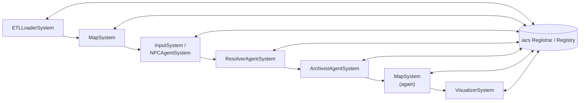
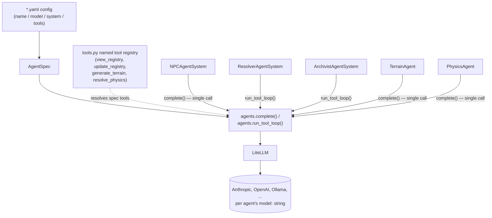
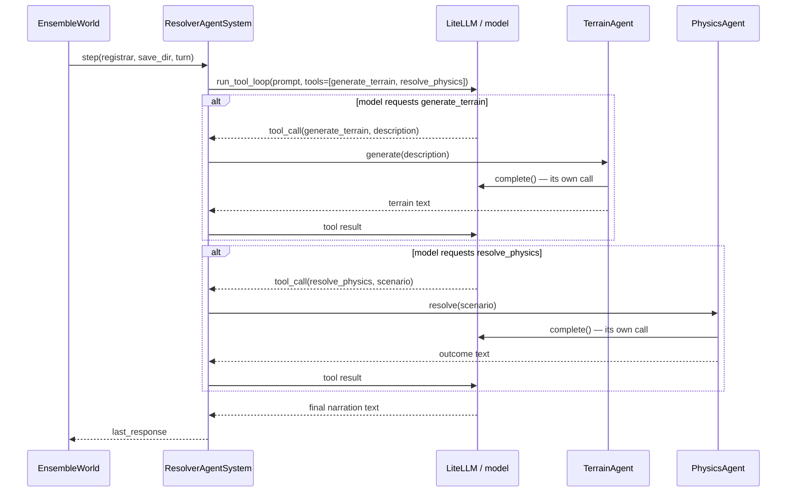

# Agent architecture

This documents the agent/model-call architecture as of the LiteLLM
migration: every agent (Resolver, Archivist, NPC, and the new Terrain and
Physics specialists) runs through the same provider-agnostic call path
instead of a hosted, Anthropic-only platform. See the git history for the
step-by-step rationale; this page is the current-state map.

## 1. One turn of `EnsembleWorld`

Every turn runs a fixed sequence of `System`s (`story_simulator/systems.py`).
Systems never call each other directly — the only channel between them is
the shared iacs `Registrar`, which each System reads from and writes to.

- **ETLLoaderSystem** loads any not-yet-seen EC files from `save_dir`.
- **MapSystem** tags nearby entities `active` and records what the
  reference character has ever perceived (`memory`).
- **InputSystem** (a human's typed command) or **NPCAgentSystem** (an
  agenda-driven NPC's decided command, when there's no human command this
  turn) writes this turn's command.
- **ResolverAgentSystem** narrates what happens (detailed below).
- **ArchivistAgentSystem** transcribes the exchange into the registry as
  entities/components.
- **MapSystem** runs again so `active`/`memory` reflect where the turn
  actually landed.
- **VisualizerSystem** re-renders the position plot.

## 2. Every agent's call path

`AgentSpec` (`story_simulator/agents.py`) is the interchange format between
"where an agent's config comes from" (today, a `*.yaml` file next to the
code — `resolver.yaml`, `archivist.yaml`, `npc.yaml`, `terrain.yaml`,
`physics.yaml`) and "how it's run." Every agent goes through the same two
entry points, `agents.complete()` (one call) and `agents.run_tool_loop()`
(a multi-turn tool-calling loop), which call LiteLLM rather than a
provider-specific SDK — so an agent's `model:` field can name any
LiteLLM-supported provider, not just Anthropic.

Which agents get a multi-turn tool loop versus a single call, and what
tools each one has, differs by role:

| Agent | Call shape | Tools |
|---|---|---|
| `NPCAgentSystem` | single `complete()` call | none |
| `ResolverAgentSystem` | `run_tool_loop()` | `generate_terrain`, `resolve_physics` |
| `ArchivistAgentSystem` | `run_tool_loop()` | `view_registry`, `update_registry`, plus every tool the iacs MCP server exposes |
| `TerrainAgent` / `PhysicsAgent` | single `complete()` call | none |

## 3. Resolver calling Terrain/Physics on demand

The Resolver is the only System that calls the Terrain and Physics
specialists — neither `TerrainAgent` nor `PhysicsAgent` is a `System`, so
`EnsembleWorld` never schedules either directly. They're reachable only
through `ResolverAgentSystem`'s own tool dispatch, on whichever turns the
Resolver's own judgment calls for them (a location with nothing established
yet, an action with a non-obvious physical outcome) — not every turn.

## 4. What's out of scope today

- **`AgentWorld`** (`--world agent`/`agent-test`) still talks to the hosted
  Anthropic Agents/Sessions platform directly — a separate, simpler code
  path from `EnsembleWorld`, untouched by this migration. It's now the only
  hosted-platform-dependent code left in the project.
- **Bring-your-own-agent (EC-defined agents)** isn't implemented. An
  unwired `agent` component type is reserved in `manifest/builtins.yaml`
  (`role`/`model`/`system_prompt` fields) as a landing spot for a future
  loader that turns an `agent` entity into an `AgentSpec` — but nothing
  reads it yet.
- **Per-provider credential management** is minimal: `resolve_anthropic_api_key()`
  (`story_simulator/config.py`) covers Anthropic-flavored `model:` strings;
  any other provider relies on LiteLLM's own standard env-var discovery
  (e.g. `OPENAI_API_KEY`).
