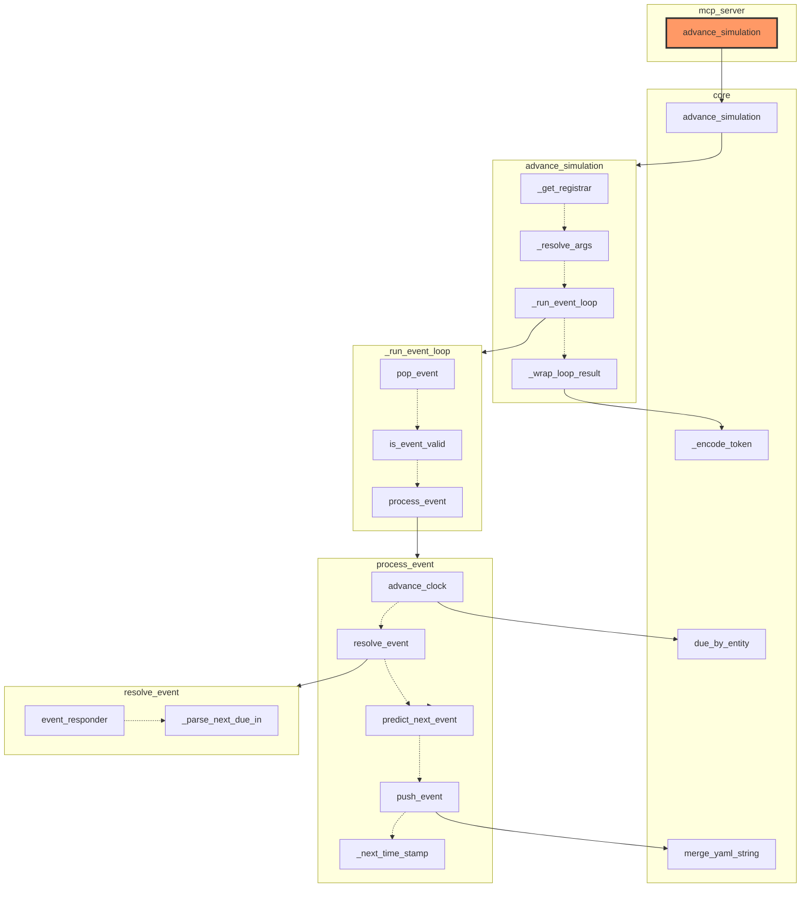
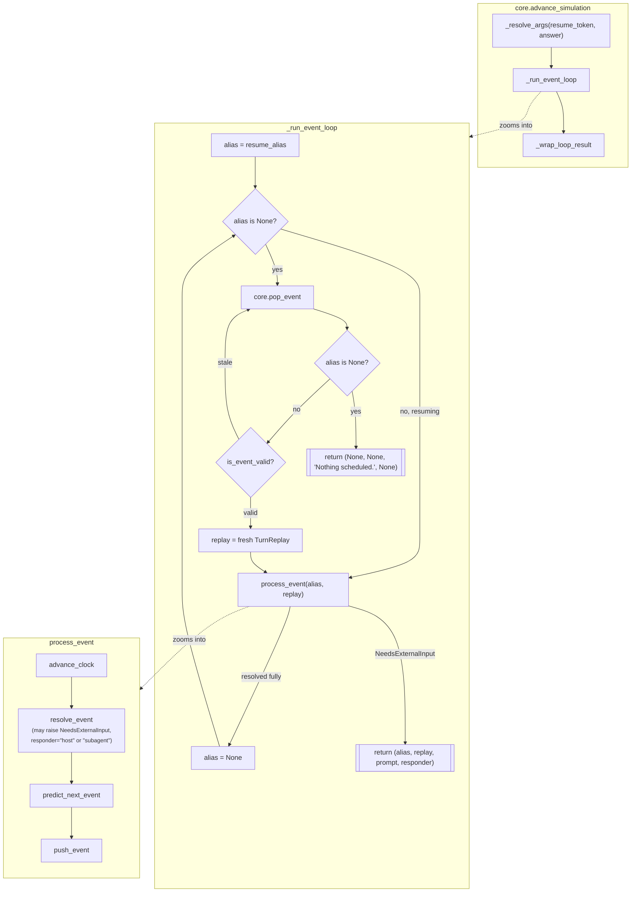

# `advance_simulation`: entry point, zoomed in

`advance_simulation` is the tool a connected host calls to drive the whole
simulation — the entry point [`docs/architecture.md`](../architecture.md)'s
"event-driven turn loop" section describes. This page zooms into that
specific entry point: (a) the file/class structure its own call graph
actually touches, generated by a new iacs capability; (b) its precise
logical flow, drawn by hand because that still needs to be (see the end of
this page); and how the two compare. Along the way, tracing this entry
point precisely enough to draw (a) automatically surfaced real bugs (in
both iacs and this codebase) and a genuine architectural concern the
maintainer acted on immediately — see below.

## Identifying entry points (background)

Before picking `advance_simulation` specifically, a few ways to *find*
entry points in general, evaluated for this codebase:

| Approach | Precision | New authoring needed | Verdict |
|---|---|---|---|
| `[project.scripts]` in `pyproject.toml` | Exact | None — already there (`story-simulator-mcp = "story_simulator.mcp_server:main"`) | Finds the *process* launcher, not the tool-level operations inside it |
| Decorator detection (`@server.tool()`) | High, for this framework | None — the pattern already exists everywhere it applies | Best automatable signal for *this* codebase: every MCP tool is exactly one of these |
| Explicit `__iacs__` tag (e.g. `{"entry_point": true}`) | Exact, by construction | Would need adding | Most robust in general, but redundant here — see below |
| Call-graph in-degree (nothing in the parsed codebase calls it) | Low, standalone | None | Flags real entry points *and* dead code identically; only useful combined with another signal |

The explicit-tag route turns out to already exist under a different name:
every `@server.tool()` function in `mcp_server.py` already carries
`__iacs__ = {"solution of": "story_simulator_mission.tool_catalog.<name>"}`
— the `tool_catalog` requirement subtree *is* an explicit, already-authored
list of entry points, with zero new schema needed. Recommendation for
automating entry-point discovery later: detect `@server.tool()`/`@mcp.tool()`
decorators via AST (the code-analysis signal), and treat entities filed
under `*.tool_catalog.*` as a cross-check/fallback (the declared signal) —
two independently-derived answers that should agree.

## (a) File/class architecture — automated

Generated with the `--root` option on `iacs generate-architecture-diagram`,
which traces every resolved `calls` edge outward from one entity instead of
collapsing the whole project to one node per file:

```
uv run --project iacs iacs --manifest story_simulator generate-architecture-diagram --root mcp_server.advance_simulation --output docs/architecture/advance_simulation.md
```

`--root advance_simulation` alone is ambiguous now and errors out
(`resolved to 2 entities`): `mcp_server.py` and `core.py` each have their
own `advance_simulation` (see below for why), so the root has to spell out
which one -- `mcp_server.advance_simulation`, the actual MCP entry point.



`mcp_server.advance_simulation` (the root, highlighted, `n0` in `sg1`)
now makes exactly one call: `core.advance_simulation` (`n1`, a plain
arrow -- one target, no order to show). That single edge *is* the point:
`mcp_server.py` used to hold this whole subgraph's worth of
implementation itself; it's since been moved into `core.py` wholesale
(session state, Postgres bootstrap, world save I/O, the event loop, the
lot -- see `core.py`'s own module docstring for why "keep it
framework-agnostic" stopped being the right call once responders became
central to how this project works, not an optional layer on top of it),
leaving `mcp_server.py` as a thin `@server.tool()` wrapper around each
`core.*` function of the same name. `mcp_server.py` keeps only the
host-facing tool docstrings and the FastMCP wiring; everything below
`core.advance_simulation`'s own box is exactly what used to hang directly
off `mcp_server.advance_simulation` before the move.

Default Mermaid theme -- an earlier version made every box's background
transparent instead, tried while tracking down the boundary-crossing-edge
bug covered next, but the transparency itself turned out not to matter
once that bug's actual cause (an explicit inner `direction` on a sequence
subgraph) was found and fixed, so it was dropped again. Solid arrows are
calls; the boxed groups are new. An entity that itself makes two or more calls gets those
targets pulled into their own box (labeled with just the caller's name),
chained internally by dotted arrows in the order it actually calls them
— e.g. `process_event`'s own box traces `advance_clock -.->
resolve_event -.-> predict_next_event -.-> push_event -.->
_next_time_stamp`, exactly its body top to bottom (`advance_clock` leads
that chain now -- it used to run once in `_run_event_loop` before
dispatching to `process_event` at all, moved inside so every write
`process_event` makes shares one "now" from the very start of handling
this entity's turn, not a value computed one function up).

The whole diagram runs top-to-bottom, including inside each box, and no
box declares its own inner direction anymore -- both are load-bearing,
not stylistic. An earlier version ran the outer diagram left-to-right
with each box explicitly set to `direction TB` internally (so a box's own
multi-step chain wouldn't get cramped running the same direction as the
outer flow). That looked right until an edge crossing a box's boundary
was checked pixel-by-pixel against where Mermaid actually drew it:
Mermaid/dagre's compound layout mis-anchors a boundary-crossing edge
whenever the box it touches declares an explicit inner `direction` at
all -- matching the outer direction or not -- rendering it as if it
started from an arbitrary other box member instead of the true source
(back when `_process_due_entity` was still its own step here, before it
was cut out as an unneeded middleman -- see below --
`_process_due_entity --> process_event` was one such case, rendering as
if it came from wherever in `_run_event_loop`'s box happened to align,
not from `_process_due_entity` itself). Dropping
the inner `direction` line entirely fixes it, but a box then has no
choice but to inherit the outer diagram's own direction -- so the only
combination that's both correct and legible is outer top-to-bottom with
no inner override, which is what's here now.

Only the *target* side of a solid arrow resolves to a box's boundary,
not the source: `_run_event_loop` is itself one of `core.advance_simulation`'s
four ordered calls (a `seq1` member) *and* separately owns its own box of
three calls (`seq3`) -- but the edge for that relationship, `n3 -->
seq3`, still names `_run_event_loop` as the specific node reaching its
own box, not some anonymous box-to-box arrow. Every box-landing edge in
this particular trace happens to be a caller reaching its own box this
same way (`n1 --> seq1`, `n8 --> seq4`, `n14 --> seq8` are the others) --
a genuinely different caller reaching into some other entity's box would
land on that box's boundary exactly the same way, just without a
first-called member named either: "something outside calls into this
whole ordered sequence" is what the box exists to show, with no
member-level provenance lost by landing on the boundary instead of a
specific member.

`_resolve_args`, another `seq1` member, has no outgoing edge at all
here -- its only call is `TurnReplay(answers=[...])`, a constructor, and
iacs's `calls` extraction now excludes those on purpose: a
call-reachability trace is meant to show callables calling other
callables, and instantiating a type isn't that (a PEP 8-capitalized call
target -- `Foo(...)`, not `foo(...)` -- is treated as a constructor and
left out). Before this exclusion, `_resolve_args --> seq3` (into
`_run_event_loop`'s box, back when `TurnReplay` was one of its members)
looked exactly like `_resolve_args` calling into `_run_event_loop`
itself, which it never actually did -- a genuinely misleading edge, an
artifact of tracing "constructs a `TurnReplay`" as if it were "calls
behavior," not just a stylistic one.

`_run_event_loop`'s own box (`seq3`) reads `pop_event -.-> is_event_valid
-.-> process_event` -- the order they actually run in for the common
case. An earlier version of `_run_event_loop` had two separate
`process_event` call sites (one on a "resuming an in-progress turn"
early-return path, one in the main loop), and the early-return one came
*first* in source, so this box used to read `process_event -.-> pop_event
-.-> is_event_valid` instead -- accurate to source order (`load_python`'s
`seq` field, and this box's chain, both go strictly by first occurrence
in the file, not by which branch actually runs first for a given call),
but backwards from how a reader would expect the loop to work. Refactored
to a single call site (`alias` starts as `resume_alias`, and the loop
only pops/validates a fresh one when `alias` is still `None`) specifically
so the common case's real order and the source's first-occurrence order
would agree -- see (b) below for the updated control flow.

The earlier flat version drew every target as its own solid arrow from
the caller *and* chained them with dotted arrows threading back through
the same targets, which just said the same thing twice and read as
clutter, not structure, once tried against this real trace. The
tradeoff of the box-based version: a node inside a sequence box no longer
shows which file it's defined in (`push_event`, born in `core.py`, sits
in `process_event`'s box here, not a `core` file box) — accepted
deliberately, since decluttering call order mattered more here than
per-node file attribution, which a full trace lists elsewhere in this
doc anyway. `load_python` records each `calls` row's
first-occurrence order as a `seq` field; `build_call_reachability`/
`_call_sequences` groups and orders a caller's own resolved targets by
it, and `render_reachability_mermaid` is what turns a 2+-target sequence
into a box like this (a 1-target one stays a plain arrow, nothing to
order) — see those two docstrings.

This traces cleanly end to end today — every real call from
`mcp_server.advance_simulation` down through `resolve_event`/
`predict_next_event`/`push_event` shows up, nothing false. It didn't
start that way; getting here surfaced four real, distinct problems, each
fixed rather than smoothed over:

1. **A false positive in iacs.** `core.pop_event`/`advance_clock` call the
   *Python builtin* `float(...)`, which coincidentally substring/alias-matched
   iacs's own `float` schema-type entity (`builtins/components.yaml`,
   always loaded alongside any manifest). **Fixed in iacs**: a
   `calls`/`imports` target now only counts once it resolves to a
   `.py`-sourced entity — Python code never calls a YAML-described entity,
   so this is a categorically correct rule, not a special case.
2. **A real gap in this codebase.** `_run_event_loop`'s actual dispatch to
   `process_event` (then still named `process_base_event`, alongside a
   character-path `process_event` since renamed away when that path was
   shelved) happened through a nested closure, `_process` (no docstring of
   its own) — so per `load_python`'s own rule
   (only docstring'd/`__iacs__`-tagged constructs become entities), those
   calls were attributed to nothing and vanished from the graph. **Fixed**
   by extracting it to a top-level function with a docstring,
   `_process_due_entity`.
3. **A self-inflicted near-repeat of #2.** The first name tried for that
   extracted function, `_dispatch_turn`, broke a *different* edge the
   moment it existed: `agents.run_tool_loop`'s generic `dispatch` callback
   parameter was itself a bare-name call, and `"dispatch"` was a substring
   of `_dispatch_turn`'s own path -- a fabricated `agents → mcp_server`
   edge appeared in the whole-project overview diagram. **Fixed** by
   renaming to `_process_due_entity`, chosen specifically to avoid
   colliding with any other bare name in the codebase -- worth remembering
   generally: a short, generic bare name is more likely to collide via
   substring matching than a specific one.
4. **What actually prompted this section to shrink this much.** Diagram
   (a)'s first real run also showed `spatial.pop_event`/`next_due_entity`
   sitting alongside actual spatial-geometry functions
   (`perceptible_entities`, `entity_position`, ...) in the same file —
   turn-scheduling bookkeeping and spatial calculation, conflated in one
   module. Seeing that plainly in the diagram is what prompted removing
   the character/npc/physics/terrain/spatial "optional modules" from the
   active codebase entirely (see [`shelved/`](../../shelved)) rather than
   just fixing that one file — this diagram, `docs/architecture.md`, and
   `docs/architecture/story_simulator.md` all reflect the result.

(Since this list was first written, `_process_due_entity`'s seam itself
was removed too. It only ever existed as a dispatch point for a
character-aware branch to return to, kept as its own step for exactly
that reason -- but that branch moved out to `shelved/` (point 4 above)
without ever coming back, and a seam nothing branches through anymore is
just indirection, not a hedge. `_run_event_loop` calls `process_event`
directly now. Since then, `_run_event_loop` itself -- along with
`_resolve_args`/`_wrap_loop_result`/`process_event`/`resolve_event` and
the rest of what used to hang directly off `mcp_server.advance_simulation`
-- moved into `core.py`, per the diagram above; `mcp_server.advance_simulation`
is a one-line wrapper around `core.advance_simulation` now.)

## (b) Logical flow — drawn by hand

Automating *this* would mean tracing control-flow order (branches, which
path a condition actually takes, loop bodies) rather than just "what calls
what" — a materially bigger feature than the reachability graph above, so
this one's manual for now, per the plan to automate it later. Traces
`core.advance_simulation`'s own control flow specifically --
`mcp_server.advance_simulation` itself has none worth drawing, just the
one-line delegation shown in (a).



`_run_event_loop` has a single `process_event` call site, not one per
branch (an earlier version did, and the auto-generated trace in (a) used
to read confusingly for it -- see the note there, right after
`_resolve_args`'s own): `alias` starts out as `resume_alias` (possibly
`None`), and the loop only pops/validates a fresh one when `alias` is
still `None`, so a resumed turn skips straight to `PROC` while a fresh
one falls through `pop_event`/`is_event_valid` first, same destination
either way.

`NeedsExternalInput` (raised by `TurnReplay.resolve` whenever this turn's
replay has no cached answer yet for that judgment call) is what makes the
pause/resume contract work: it unwinds straight to `_run_event_loop`'s own
`try`/`except`, skipping over `process_event`/`resolve_event` in between,
not caught anywhere along the way.

## Comparison against `docs/architecture.md`

The two are drawn to match now — `docs/architecture.md`'s "event-driven
turn loop" diagram was rewritten from this page's findings rather than
left to drift, once the character/npc/physics/terrain/spatial removal
(see (a) point 4 above) made the gap unambiguous rather than debatable:
before that removal, comparing this page's automated trace against the
old hand-drawn diagram found it described a `character_communication`
loop that didn't exist in the running code, an `update_data` step that
was actually conditional and nested three levels down rather than a peer
of `resolve_event`, only one of two `_run_event_loop` branches, and no
depiction of the pause/resume contract at all — differences worth
surfacing rather than assuming "should be similar" meant "verify it's
fine." With the character-aware branch actually gone from the codebase
now (not just under-documented), there was no longer a real question of
whether the diagram or the code was the one that had drifted.

`predict_next_event`/`push_event` being the same function at both the
reschedule-after-processing call site and, elsewhere, brand-new-entity
setup — the "same function as" edge in `docs/architecture.md`'s diagram —
still holds up; that part was accurate all along.
