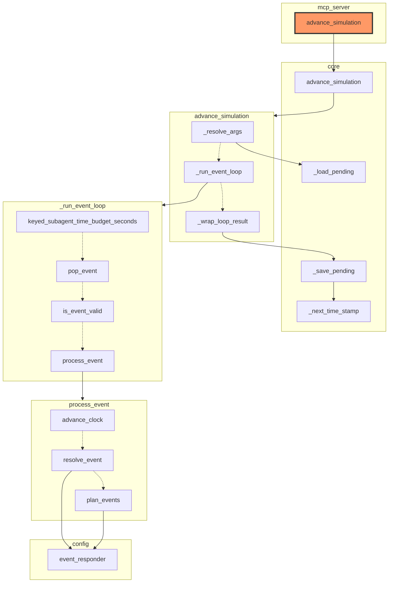

# Architecture diagram

Entities reachable from `mcp_server.advance_simulation` by following `calls` edges outward (the root is highlighted); grouped into one subgraph per source file, except where noted next. An entity that itself makes two or more calls gets its call targets pulled into their own subgraph instead, chained top to bottom by dotted arrows in the order it actually calls them (skipping over any unresolved call in between). A solid `calls` arrow landing on a node inside such a subgraph is drawn to the subgraph's own boundary instead, but always starts from the specific node making the call, even if that node is itself inside a subgraph. One call with one destination stays a plain arrow -- there's no order to show.

