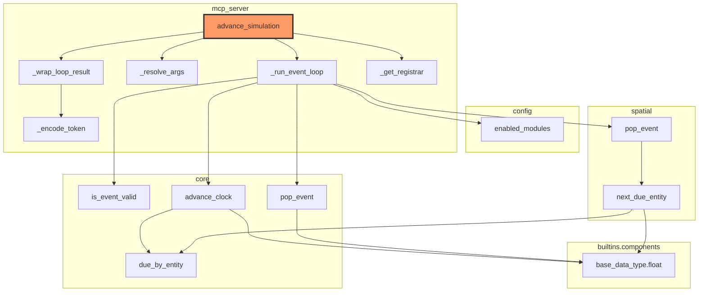

# `advance_simulation`: entry point, zoomed in

`advance_simulation` is the tool a connected host calls to drive the whole
simulation — the single entry point [`docs/architecture.md`](../architecture.md)'s
"event-driven turn loop" diagram already describes in the abstract. This
page zooms into that specific entry point: (a) the file/class structure
its own call graph actually touches, generated by a new iacs capability;
(b) its precise logical flow, drawn by hand because that still needs to be
(see the end of this page); and a comparison against the existing diagram.

## Identifying entry points (background)

Before picking `advance_simulation` specifically, a few ways to *find*
entry points in general, evaluated for this codebase:

| Approach | Precision | New authoring needed | Verdict |
|---|---|---|---|
| `[project.scripts]` in `pyproject.toml` | Exact | None — already there (`story-simulator-mcp = "story_simulator.mcp_server:main"`) | Finds the *process* launcher, not the tool-level operations inside it |
| Decorator detection (`@server.tool()`) | High, for this framework | None — the pattern already exists everywhere it applies | Best automatable signal for *this* codebase: every MCP tool is exactly one of these |
| Explicit `__iacs__` tag (e.g. `{"entry_point": true}`) | Exact, by construction | Would need adding | Most robust in general, but redundant here — see below |
| Call-graph in-degree (nothing in the parsed codebase calls it) | Low, standalone | None | Flags real entry points *and* dead code identically; only useful combined with another signal |

The explicit-tag route turns out to already exist under a different name:
every `@server.tool()` function in `mcp_server.py` already carries
`__iacs__ = {"solution of": "story_simulator_mission.tool_catalog.<name>"}`
— the `tool_catalog` requirement subtree *is* an explicit, already-authored
list of entry points, with zero new schema needed. Recommendation for
automating entry-point discovery later: detect `@server.tool()`/`@mcp.tool()`
decorators via AST (the code-analysis signal), and treat entities filed
under `*.tool_catalog.*` as a cross-check/fallback (the declared signal) —
two independently-derived answers that should agree.

## (a) File/class architecture — automated

Generated with the new `--root` option on `iacs generate-architecture-diagram`,
which traces every resolved `calls` edge outward from one entity instead of
collapsing the whole project to one node per file:

```
uv run --project iacs iacs --manifest story_simulator generate-architecture-diagram --root advance_simulation --output docs/architecture/advance_simulation.md
```



**Two real limitations this run surfaced, not smoothed over:**

1. **`n12` ("builtins.components" / `base_data_type.float`) is a false
   positive.** `core.pop_event`/`advance_clock`/`spatial.next_due_entity`
   all call the *Python builtin* `float(...)`. That bare name resolves via
   substring/alias matching against iacs's own `float` schema-type entity
   (`builtins/components.yaml`, always loaded alongside any manifest) —
   the same alias, coincidentally. Any bare-name Python builtin call
   (`float`, `int`, `str`, `list`, `dict`, ...) is at risk of this same
   collision. Worth a follow-up: exclude iacs's own builtins-sourced
   entities from `calls`/`imports` resolution targets by default, the same
   way `non_format_guide_ids` already excludes `format_guide.yaml`.

2. **The single most important edge is missing.** `_run_event_loop`'s
   actual dispatch to `process_event`/`process_base_event` happens through
   a nested closure, `_process` (defined inside `_run_event_loop`, no
   docstring of its own) — so per `load_python`'s own rule (only
   docstring'd/`__iacs__`-tagged constructs become entities), those calls
   are attributed to nothing and vanish from the graph. Tried the obvious
   fix (add `_process` a one-line docstring) and reverted it: doing so
   made `_process`'s new entity path (`..._run_event_loop._process`) a
   substring of `_run_event_loop`'s own path, and since `_run_event_loop`'s
   *alias* is the two-segment `mcp_server._run_event_loop` (not the bare
   leaf name), a bare `"_run_event_loop"` call target no longer resolves
   by exact alias match — it fell through to substring matching, found
   two candidates, and silently went unresolved instead, deleting a
   *previously correct* edge to fix a different one. That's a sharper,
   more general edge in `candidate_entity_ids`' substring resolution than
   this one collision: a short bare-name call target (exactly what local/
   nested calls naturally look like in Python) can be broken by adding an
   unrelated entity elsewhere in the tree. Left both call sites as-is
   rather than trade one gap for a regression.

## (b) Logical flow — drawn by hand

Automating *this* would mean tracing control-flow order (branches, which
path a condition actually takes, loop bodies) rather than just "what calls
what" — a materially bigger feature than the reachability graph above, so
this one's manual for now, per the plan to automate it later.

```mermaid
flowchart TD
    subgraph AS["advance_simulation"]
        direction TB
        RA["_resolve_args(resume_token, answer)"] --> REL[_run_event_loop] --> WR[_wrap_loop_result]
    end

    subgraph Loop["_run_event_loop"]
        direction TB
        RESUME{resume_alias given?}
        RESUME -- yes --> PROC0["_process(resume_alias, replay)"]
        PROC0 -- "NeedsExternalInput" --> PAUSE1[["return (alias, replay, prompt, responder)"]]
        PROC0 -- resolved fully --> L1
        RESUME -- no --> L1[pop_event]
        L1 --> EMPTY{alias is None?}
        EMPTY -- yes --> DONE[["return (None, None, 'Nothing scheduled.', None)"]]
        EMPTY -- no --> V{is_event_valid?}
        V -- stale --> L1
        V -- valid --> ADV[advance_clock] --> PROC["_process(alias, fresh TurnReplay)"]
        PROC -- "NeedsExternalInput" --> PAUSE2[["return (alias, replay, prompt, responder)"]]
        PROC -- resolved fully --> L1
    end

    subgraph Dispatch["_process"]
        direction TB
        CHAR{character module enabled?}
        CHAR -- yes --> PE[process_event]
        CHAR -- no --> PBE[process_base_event]
    end

    subgraph PE_detail["process_event"]
        direction TB
        CC[character_communication] --> RE[resolve_event] --> PRED1[predict_event] --> PUSH1[push_event]
    end

    subgraph CC_detail["character_communication"]
        direction TB
        SC[select_character] --> NC[narrate_to_character] --> GI["get_character_input\n(may raise NeedsExternalInput)"]
    end

    subgraph PBE_detail["process_base_event"]
        direction TB
        RBE["resolve_base_event\n(may raise NeedsExternalInput)"] --> PRED2[predict_event] --> PUSH2[push_event]
    end

    L1 -. pop_event is character-aware:\nspatial.pop_event if enabled,\ncore.pop_event otherwise .- L1
    REL -. zooms into .-> Loop
    PROC -. zooms into .-> Dispatch
    PROC0 -. zooms into .-> Dispatch
    PE -. zooms into .-> PE_detail
    CC -. zooms into .-> CC_detail
    PBE -. zooms into .-> PBE_detail
```

`NeedsExternalInput` (raised by `TurnReplay.resolve`/
`resolve_preferring_subagent` whenever this turn's replay has no cached
answer yet for that judgment call) is what makes the pause/resume contract
work: it unwinds straight to `_run_event_loop`'s own `try`/`except`,
skipping over every intervening frame (`process_event` →
`character_communication` → `get_character_input`, or `process_event` →
`resolve_event`), not caught anywhere in between.

## (3) Comparison against `docs/architecture.md`'s event-loop diagram

Similar in shape, as expected — same underlying loop — but zooming in from
the real entry point surfaced four concrete, specific differences, not
just a confirmation:

1. **No "Update data" step in `process_event`.** The existing diagram
   shows `Character communication → Resolve event → Update data` as three
   peer steps. In the real code, `update_data` is called *conditionally*,
   *nested inside* `resolve_event`'s NPC-only tool loop (only when the NPC
   resolver decides to call the `update_data` tool) — never for the
   player-voiced path, which the docstring explicitly says calls
   `update_registry` itself, entirely outside this mechanism. It isn't a
   peer step at all.
2. **No loop in `character_communication`.** The existing diagram draws
   `Select character → Narrate to character → Get character input → (back
   to) Select character`. The real function is a straight line with no
   loop — it runs once and returns `(scene, action_text)`.
3. **Only one of two branches is shown.** The existing diagram documents
   the character-module path only. `_run_event_loop` actually branches on
   `enabled_modules()`: `spatial.pop_event`/`process_event` when the
   character module is active, `core.pop_event`/`process_base_event`
   (no character concept at all) when it isn't.
4. **The pause/resume contract itself is entirely new.** The existing
   diagram documents the generic Sedgewick & Wayne event-loop shape in the
   abstract. It has no notion of `NeedsExternalInput`, `resume_token`, or
   `TurnReplay` — the MRTR mechanism that's arguably the single most
   distinctive thing about `advance_simulation` specifically (as opposed
   to "an event loop" generically) doesn't appear at all.

`predict_event`/`push_event` are drawn correctly (same function serving
both the reschedule-after-processing call site and, elsewhere, brand-new
entity setup — that "same function as" edge holds up), and the overall
pop → valid? → advance clock → process → reschedule shape is right. The
divergences are all about what happens *inside* "Process event" and how
many paths there are through it — exactly the kind of detail that only
shows up once you actually trace a real entry point instead of describing
the pattern from memory.
