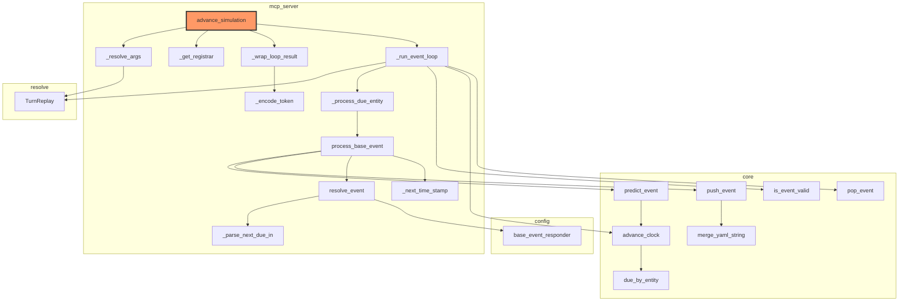

# `advance_simulation`: entry point, zoomed in

`advance_simulation` is the tool a connected host calls to drive the whole
simulation — the entry point [`docs/architecture.md`](../architecture.md)'s
"event-driven turn loop" section describes. This page zooms into that
specific entry point: (a) the file/class structure its own call graph
actually touches, generated by a new iacs capability; (b) its precise
logical flow, drawn by hand because that still needs to be (see the end of
this page); and how the two compare. Along the way, tracing this entry
point precisely enough to draw (a) automatically surfaced real bugs (in
both iacs and this codebase) and a genuine architectural concern the
maintainer acted on immediately — see below.

## Identifying entry points (background)

Before picking `advance_simulation` specifically, a few ways to *find*
entry points in general, evaluated for this codebase:

| Approach | Precision | New authoring needed | Verdict |
|---|---|---|---|
| `[project.scripts]` in `pyproject.toml` | Exact | None — already there (`story-simulator-mcp = "story_simulator.mcp_server:main"`) | Finds the *process* launcher, not the tool-level operations inside it |
| Decorator detection (`@server.tool()`) | High, for this framework | None — the pattern already exists everywhere it applies | Best automatable signal for *this* codebase: every MCP tool is exactly one of these |
| Explicit `__iacs__` tag (e.g. `{"entry_point": true}`) | Exact, by construction | Would need adding | Most robust in general, but redundant here — see below |
| Call-graph in-degree (nothing in the parsed codebase calls it) | Low, standalone | None | Flags real entry points *and* dead code identically; only useful combined with another signal |

The explicit-tag route turns out to already exist under a different name:
every `@server.tool()` function in `mcp_server.py` already carries
`__iacs__ = {"solution of": "story_simulator_mission.tool_catalog.<name>"}`
— the `tool_catalog` requirement subtree *is* an explicit, already-authored
list of entry points, with zero new schema needed. Recommendation for
automating entry-point discovery later: detect `@server.tool()`/`@mcp.tool()`
decorators via AST (the code-analysis signal), and treat entities filed
under `*.tool_catalog.*` as a cross-check/fallback (the declared signal) —
two independently-derived answers that should agree.

## (a) File/class architecture — automated

Generated with the `--root` option on `iacs generate-architecture-diagram`,
which traces every resolved `calls` edge outward from one entity instead of
collapsing the whole project to one node per file:

```
uv run --project iacs iacs --manifest story_simulator generate-architecture-diagram --root advance_simulation --output docs/architecture/advance_simulation.md
```



This traces cleanly end to end today — every real call from
`advance_simulation` down through `resolve_event`/`predict_event`/
`push_event` shows up, nothing false. It didn't start that way; getting
here surfaced four real, distinct problems, each fixed rather than
smoothed over:

1. **A false positive in iacs.** `core.pop_event`/`advance_clock` call the
   *Python builtin* `float(...)`, which coincidentally substring/alias-matched
   iacs's own `float` schema-type entity (`builtins/components.yaml`,
   always loaded alongside any manifest). **Fixed in iacs**: a
   `calls`/`imports` target now only counts once it resolves to a
   `.py`-sourced entity — Python code never calls a YAML-described entity,
   so this is a categorically correct rule, not a special case.
2. **A real gap in this codebase.** `_run_event_loop`'s actual dispatch to
   `process_event`/`process_base_event` happened through a nested closure,
   `_process` (no docstring of its own) — so per `load_python`'s own rule
   (only docstring'd/`__iacs__`-tagged constructs become entities), those
   calls were attributed to nothing and vanished from the graph. **Fixed**
   by extracting it to a top-level function with a docstring,
   `_process_due_entity` — visible above as `n6`.
3. **A self-inflicted near-repeat of #2.** The first name tried for that
   extracted function, `_dispatch_turn`, broke a *different* edge the
   moment it existed: `agents.run_tool_loop`'s generic `dispatch` callback
   parameter was itself a bare-name call, and `"dispatch"` was a substring
   of `_dispatch_turn`'s own path -- a fabricated `agents → mcp_server`
   edge appeared in the whole-project overview diagram. **Fixed** by
   renaming to `_process_due_entity`, chosen specifically to avoid
   colliding with any other bare name in the codebase -- worth remembering
   generally: a short, generic bare name is more likely to collide via
   substring matching than a specific one.
4. **What actually prompted this section to shrink this much.** Diagram
   (a)'s first real run also showed `spatial.pop_event`/`next_due_entity`
   sitting alongside actual spatial-geometry functions
   (`perceptible_entities`, `entity_position`, ...) in the same file —
   turn-scheduling bookkeeping and spatial calculation, conflated in one
   module. Seeing that plainly in the diagram is what prompted removing
   the character/npc/physics/terrain/spatial "optional modules" from the
   active codebase entirely (see [`shelved/`](../../shelved)) rather than
   just fixing that one file — this diagram, `docs/architecture.md`, and
   `docs/architecture/story_simulator.md` all reflect the result.

## (b) Logical flow — drawn by hand

Automating *this* would mean tracing control-flow order (branches, which
path a condition actually takes, loop bodies) rather than just "what calls
what" — a materially bigger feature than the reachability graph above, so
this one's manual for now, per the plan to automate it later.

```mermaid
flowchart TD
    subgraph AS["advance_simulation"]
        direction TB
        RA["_resolve_args(resume_token, answer)"] --> REL[_run_event_loop] --> WR[_wrap_loop_result]
    end

    subgraph Loop["_run_event_loop"]
        direction TB
        RESUME{resume_alias given?}
        RESUME -- yes --> PROC0["_process_due_entity(resume_alias, replay)"]
        PROC0 -- "NeedsExternalInput" --> PAUSE1[["return (alias, replay, prompt, responder)"]]
        PROC0 -- resolved fully --> L1
        RESUME -- no --> L1[core.pop_event]
        L1 --> EMPTY{alias is None?}
        EMPTY -- yes --> DONE[["return (None, None, 'Nothing scheduled.', None)"]]
        EMPTY -- no --> V{is_event_valid?}
        V -- stale --> L1
        V -- valid --> ADV[advance_clock] --> PROC["_process_due_entity(alias, fresh TurnReplay)"]
        PROC -- "NeedsExternalInput" --> PAUSE2[["return (alias, replay, prompt, responder)"]]
        PROC -- resolved fully --> L1
    end

    subgraph PBE_detail["_process_due_entity -> process_base_event"]
        direction TB
        RBE["resolve_event<br/><small>(may raise NeedsExternalInput,<br/>responder=\"host\" or \"subagent\")</small>"] --> PRED2[predict_event] --> PUSH2[push_event]
    end

    REL -. zooms into .-> Loop
    PROC -. zooms into .-> PBE_detail
    PROC0 -. zooms into .-> PBE_detail
```

`NeedsExternalInput` (raised by `TurnReplay.resolve` whenever this turn's
replay has no cached answer yet for that judgment call) is what makes the
pause/resume contract work: it unwinds straight to `_run_event_loop`'s own
`try`/`except`, skipping over `_process_due_entity`/`process_base_event`/
`resolve_event` in between, not caught anywhere along the way.

## Comparison against `docs/architecture.md`

The two are drawn to match now — `docs/architecture.md`'s "event-driven
turn loop" diagram was rewritten from this page's findings rather than
left to drift, once the character/npc/physics/terrain/spatial removal
(see (a) point 4 above) made the gap unambiguous rather than debatable:
before that removal, comparing this page's automated trace against the
old hand-drawn diagram found it described a `character_communication`
loop that didn't exist in the running code, an `update_data` step that
was actually conditional and nested three levels down rather than a peer
of `resolve_event`, only one of two `_run_event_loop` branches, and no
depiction of the pause/resume contract at all — differences worth
surfacing rather than assuming "should be similar" meant "verify it's
fine." With the character-aware branch actually gone from the codebase
now (not just under-documented), there was no longer a real question of
whether the diagram or the code was the one that had drifted.

`predict_event`/`push_event` being the same function at both the
reschedule-after-processing call site and, elsewhere, brand-new-entity
setup — the "same function as" edge in `docs/architecture.md`'s diagram —
still holds up; that part was accurate all along.
