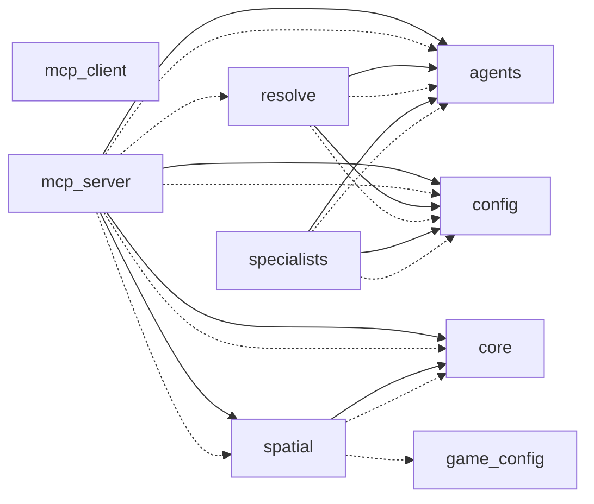

# Generated file/call-structure diagram

Unlike the hand-drawn diagrams in [`docs/architecture.md`](../architecture.md),
this one isn't authored — it's parsed straight out of `story_simulator/`'s
own source by iacs's `load_python` ETL step (module/class/function entities
from docstrings and `__iacs__` metadata, same as any other iacs entity) plus
a new static AST pass that records `calls`/`imports` relations alongside
them, collapsed to one node per file. Solid arrows are calls, dashed arrows
are imports.

Regenerate with (from a checkout of iacs with the `calls`/`imports`
extraction — see caveat below):

```
uv run --project iacs iacs --manifest story_simulator generate-architecture-diagram --output docs/architecture/story_simulator.md
```

> **Not yet merged upstream.** This capability lives on
> [`zhafen/iacs#claude/architecture-diagrams`](https://github.com/zhafen/iacs/tree/claude/architecture-diagrams),
> not yet on iacs's `main` — the diagram below is a one-time snapshot
> generated against that branch, not something the `iacs` submodule pinned
> here can reproduce yet. Once that branch merges and the submodule pointer
> bumps, regenerating in place will keep this current.



`mcp_server` is the hub, matching [`docs/architecture.md`](../architecture.md)'s
description of it as the turn-processing layer: it calls into `agents`
(the tool-calling loop), `config`, `core` (the event-loop kernel),
`resolve`, and `spatial` (character selection/narration). `mcp_client.py`
has no edges here because none of its own entities have a docstring yet
(see `load_python`'s own docstring for why undocumented code is excluded
rather than shown as noise) — it isn't disconnected from the real system,
just from what's currently documented.
